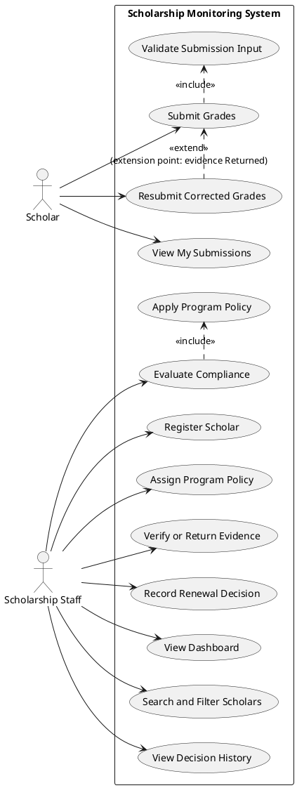
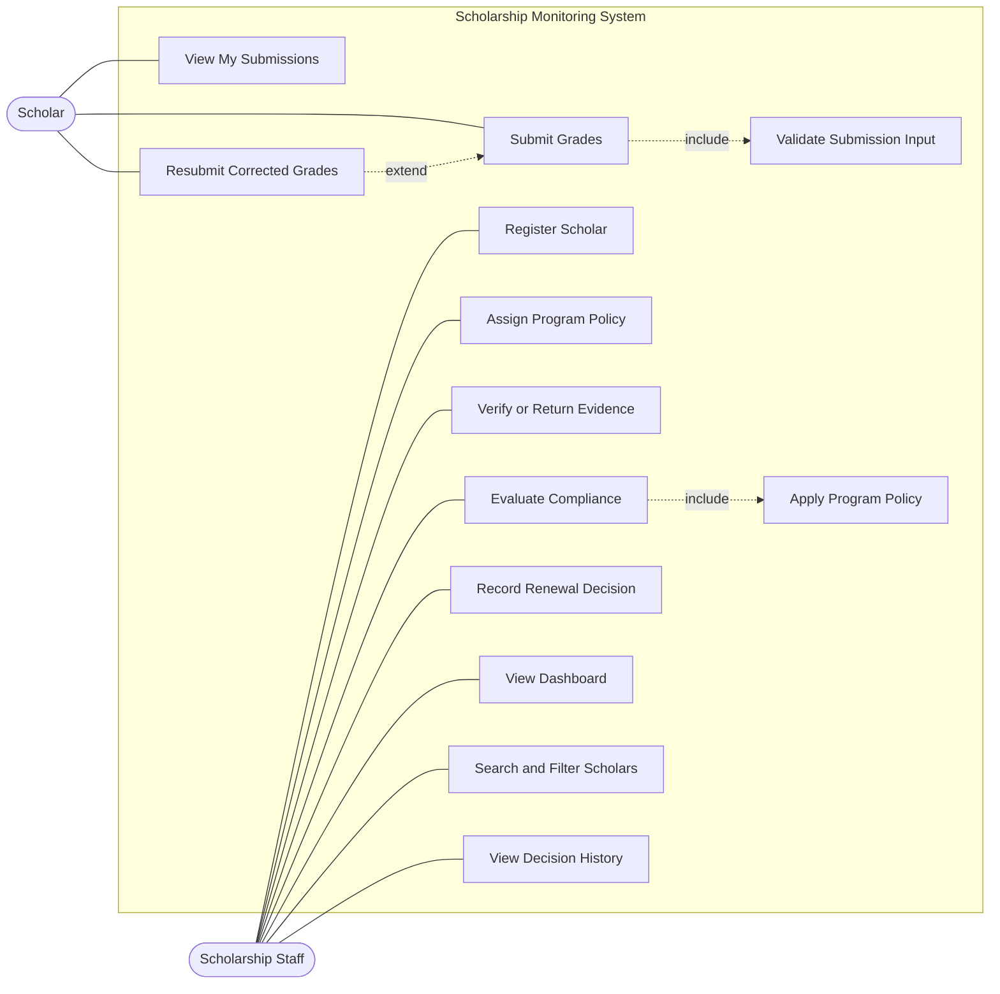
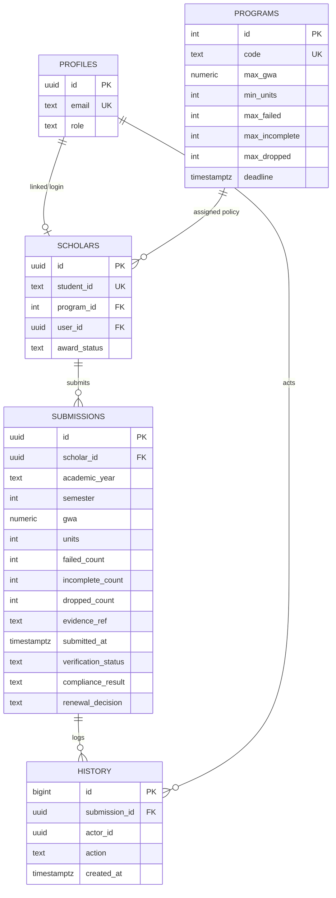

# Part I: Analysis and Design
Student Scholarship Monitoring and Academic Compliance System · SAD Midterm Section A

## A1 Investigation and planning
**Problem statement.** The Scholarship Office renews Merit and Community scholarships using spreadsheets, email attachments and paper grade records. Scholars cannot see whether a submission was received, verified or returned, and staff cannot apply program rules consistently, so renewal decisions are slow and uneven.

| # | Problem | Cause | Effect |
|---|---|---|---|
| 1 | Duplicate semester entries | Records kept in separate spreadsheets and emails | Staff reconcile copies by hand; wrong version may be used |
| 2 | Unverified grades reach decisions | No required verification step before evaluation | Renewals rest on unchecked evidence |
| 3 | Missed or disputed deadlines | Submission times not recorded consistently | Late and on-time scholars are treated differently |
| 4 | Inconsistent decisions | Policy thresholds applied from memory per program | Scholars with identical records get different outcomes |

**Scope.** Browser-based MVP with Scholar and Scholarship Staff roles: login, scholar registration and program assignment, semester grade submission, verification and return, rule-based compliance evaluation, renewal decision, dashboard, search, filter, and audit history.
**Exclusions.** Registrar API, official grade changes, payments, SMS, appeals, policy exceptions, machine learning, and real student data.

**Development tasks.** (1) Create schema, policies and test accounts. (2) Build submission and validation. (3) Build verification, evaluation and renewal workflow. (4) Build dashboard, search, tests and documentation.

| Risk | Response |
|---|---|
| Role access only hidden in the UI | Enforce with RLS and server functions; test with TC08 |
| Time runs out before the full path works | Build the mandatory path first; styling last; keep the seeded tests as the stopping check |

## A2 Stakeholders and elicitation
| Stakeholder | Interest | Actor? |
|---|---|---|
| Scholar | Submit grades, see status | **Actor** |
| Scholarship Staff | Verify, evaluate, decide | **Actor** |
| Registrar | Source of official grades | Not an actor (no direct system interaction; staff compare against its records) |
| Scholarship Office head / sponsors | Consistent, auditable policy | Not an actor (reads outcomes through staff) |

**Elicitation questions (open-ended)**
1. Walk me through how you check a grade document today. What makes you accept or reject it? *(verification)*
2. What happens, step by step, when a scholar submits after the deadline? *(deadlines)*
3. Describe a case where you granted or considered an exception. What decided it? *(policy exceptions)*
4. Who should be able to see or change a scholar's record, and why? *(access)*
5. What do you tell a scholar who asks where their submission stands? *(status visibility)*
6. Which reports or counts do you prepare each semester, and for whom? *(reports)*

## A3 Requirements and business rules
**Functional requirements**
| ID | Requirement (testable) |
|---|---|
| FR01 | Users sign in with email and password and hold one role (Scholar or Staff). A scholar can read only their own submissions; staff can read all. This is enforced by the database, not by hidden buttons. |
| FR02 | Staff register a scholar (unique student ID, name) and assign one of two stored program records. Evaluation reads thresholds from the assigned record. |
| FR03 | A scholar submits academic year, semester, GWA, enrolled units, failed, incomplete and dropped counts, and a grade-document reference. The system stores a server timestamp. |
| FR04 | The system rejects GWA outside 1.00-5.00, negative or non-integer counts, and a missing evidence reference, with a message that names the problem. |
| FR05 | The system rejects a second submission for the same scholar, academic year and semester. |
| FR06 | Staff mark pending evidence Verified or Returned; a reason is required to return. A returned record can be corrected and resubmitted and then becomes Pending verification. |
| FR07 | Evaluation is allowed only for Verified submissions. It shows each policy check and every deficiency reason, and sets Compliant or With Deficiency. |
| FR08 | Staff record Approved or Held with a note. Approval requires a Compliant evaluation; scholars cannot record decisions. |
| FR09 | The dashboard shows assigned scholars, pending verification, compliant and with deficiency for the chosen semester; staff search by student ID or name and filter by program or compliance. |
| FR10 | Verification, evaluation, renewal and resubmission changes are logged with actor, timestamp, old and new value, and note. Data survives refresh. |

**Non-functional requirements**
| ID | Requirement | Measure |
|---|---|---|
| NFR01 | Responsiveness | Dashboard, search and filter update in 2 s or less with 100 scholars on a normal connection |
| NFR02 | Access integrity | 0 successful direct table writes from a client; 100% of writes pass through checked functions (TC08) |
| NFR03 | Usability of errors | 100% of rejected actions in TC06-TC07 display a message stating the cause |
| NFR04 | Persistence and audit | 100% of records and history entries remain after refresh; each status change has an actor and timestamp |

**Business rules**
| ID | Rule |
|---|---|
| BR01 | Only staff verify evidence, evaluate compliance and decide renewal. Scholars act only on their own records. |
| BR02 | Only Verified evidence may be evaluated. Missing or unverified evidence prevents final evaluation. |
| BR03 | The policy is selected by the scholar's program: Merit (GWA <= 1.75, units >= 18, 0 failed, 0 INC, 0 dropped) or Community (GWA <= 2.25, units >= 15, 0 failed, 0 INC, <= 1 dropped). 1.00 is best; a smaller GWA is better. |
| BR04 | Deadline is 2026-10-30 17:00 Asia/Manila. Exactly 17:00 is on time; later is late and produces a deficiency. |
| BR05 | One submission per scholar, academic year and semester. |
| BR06 | Approval requires Compliant. Held is always allowed. A deficiency flag does not disqualify; award status is separate and the system does not change official grades or pay anyone. |

## A4 UML use case model

Authentication (UC01) and session handling are preconditions, not included in every use case.

**Justification**
- *Submit Grades includes Validate Submission Input:* validation always runs on every submission, and it is reused by the correction path, so it is mandatory shared behavior.
- *Evaluate Compliance includes Apply Program Policy:* an evaluation cannot happen without reading the thresholds of the scholar's program; it is the same mandatory step for both programs.
- *Resubmit Corrected Grades extends Submit Grades:* it runs only when staff have returned the evidence (the extension point); a first submission never takes it. The arrow points from the extension to the base.

## A5 Detailed use cases and data design
### UC03 Submit Grades
| Item | Content |
|---|---|
| Actor | Scholar |
| Trigger | Scholar chooses to submit a semester summary |
| Preconditions | Signed in as a scholar linked to a scholar record (FR01) |
| Main flow | 1. Scholar selects academic year and semester. 2. Scholar enters GWA, units, failed, incomplete and dropped counts. 3. Scholar enters the grade-document reference. 4. Scholar submits. 5. System validates input (include UC13). 6. System checks no submission exists for that scholar, year and semester. 7. System stores the record with a server timestamp and status Pending verification. 8. System logs the submission and confirms receipt. |
| Alternative flows | 6a. A record exists with status Returned: Resubmit Corrected Grades extension applies; the record is updated and returns to Pending. |
| Exception flows | 5a. Invalid GWA, negative count or missing reference: reject with a specific message, store nothing. 6b. A record exists and is not Returned: reject as duplicate. |
| Postcondition | One Pending submission exists for the term, with timestamp and history entry. |
| Links | FR03, FR04, FR05, FR10; BR05 |

### UC09 Evaluate Compliance
| Item | Content |
|---|---|
| Actor | Scholarship Staff |
| Trigger | Staff select a submission and choose Evaluate |
| Preconditions | Signed in as staff; submission exists (FR01) |
| Main flow | 1. Staff open the submission. 2. Staff choose Evaluate. 3. System confirms evidence is Verified. 4. System loads the scholar's program thresholds (include UC14). 5. System checks GWA, units, failed, incomplete and dropped counts and the deadline. 6. System lists each check as pass or fail. 7. If all pass, result is Compliant; otherwise With Deficiency with one reason per failed check. 8. System saves result and logs the change. |
| Alternative flows | 7a. Re-evaluation changes the result from Compliant to With Deficiency: an earlier Approved decision is cleared and logged. |
| Exception flows | 3a. Evidence is Pending or Returned: block with message "Evidence must be Verified first". 3b. Evidence reference missing: block. |
| Postcondition | Compliance result and reasons are stored; submission and award statuses are unchanged. |
| Links | FR06, FR07, FR10; BR02, BR03, BR04 |

### ERD

Unique key on SUBMISSIONS: (scholar_id, academic_year, semester). A scholar has zero or many submissions; a program has many scholars; a profile links to zero or one scholar (staff have none).

## A6 Traceability
| FR | Actor | Use case | Business rule | Implemented screen or function | Test and expected result |
|---|---|---|---|---|---|
| FR03 / FR05 | Scholar | UC03 Submit Grades | BR05 | Scholar form; `submit_grades()` | TC07: duplicate semester rejected with "Duplicate submission" message |
| FR07 | Staff | UC09 Evaluate Compliance | BR02, BR03, BR04 | Staff detail panel "Evaluate compliance"; `evaluate_submission()` | TC04: A04 is With Deficiency with units and incomplete reasons; TC06: A06 blocked |
| FR08 | Staff | UC10 Record Renewal Decision | BR06 | Approve and Hold buttons; `decide_renewal()` | TC10: compliant approved, deficient cannot be approved, held with note |
| FR01 | Scholar, Staff | UC05 and UC08 | BR01 | RLS policies; function role checks | TC08: scholar cannot read another record or verify |

**Planned requirements not implemented:** none omitted from FR01-FR10 at design time. Not provided by design: changing award status, policy exceptions, appeals and payments. Confirm this line after running TC01-TC10 and record any defect in `Test_Results.md`.
